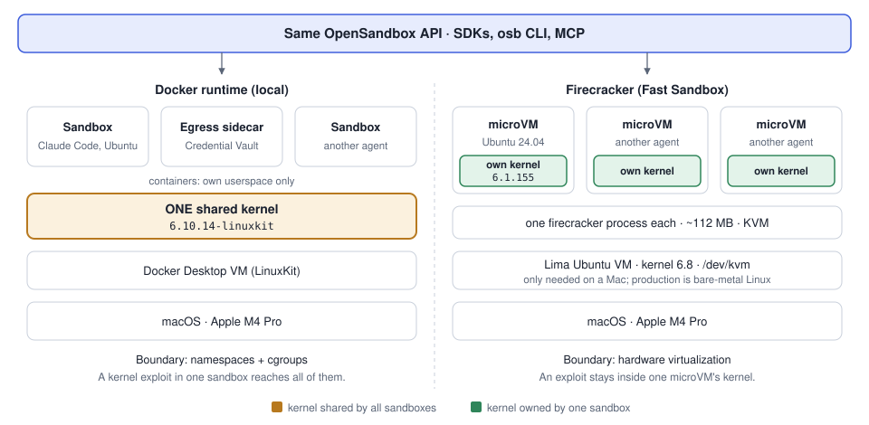

# Learning OpenSandbox

My notes and runnable examples from learning [OpenSandbox](https://github.com/alibaba/OpenSandbox), the sandbox
runtime for AI agents that Alibaba donated to the Agentic AI Foundation (AAIF). Started Nov 2026 while preparing
the CAST-SD × CES keynote (UC San Diego, Nov 21, 2026).

Learned against upstream `e10bebdd3` (2026-11-12) with `opensandbox-server` from `uvx` on macOS (Apple silicon) and
Docker Desktop.



## Contents

| Path | What it is |
| --- | --- |
| [notes/learning-path.md](notes/learning-path.md) | Architecture tour, what's interesting, the hands-on order |
| [notes/credential-vault-demo-output.md](notes/credential-vault-demo-output.md) | Recorded output of the Credential Vault demo (keynote backup) |
| [notes/setup-log.md](notes/setup-log.md) | Problems I hit and how I fixed them |
| [examples/hello_sandbox.py](examples/hello_sandbox.py) | Create an alpine sandbox, run a command, write and run a script |
| [examples/claude_in_sandbox.py](examples/claude_in_sandbox.py) | Claude Code running headless inside a sandbox, with session resume |
| [examples/credential_vault_claude.py](examples/credential_vault_claude.py) | Credential Vault: Claude Code with a fake key; the egress sidecar injects the real one |
| [sandbox.env.example](sandbox.env.example) | SDK connection settings (copy to `~/.sandbox.env`) |

## Progress

- [x] Server running locally on Docker, with an API key
- [x] Hello world
- [x] Claude Code inside a sandbox (headless + resume)
- [x] Credential Vault: agent gets a fake key, egress sidecar injects the real one
- [x] Try Firecracker: microVM booted in a Lima VM, own kernel, one process. See [notes/firecracker.md](notes/firecracker.md); setup in
      [firecracker/](firecracker/).
- [ ] Write an AAIF blog post about learning OpenSandbox. Outline: [notes/aaif-blogpost.md](notes/aaif-blogpost.md)
- [ ] Read OSEP-0012 (Credential Vault) and OSEP-0014 (multi-tenancy)
- [ ] First contribution (starter bug #2660, then identity threads #2621 / #2627)

## Quick start

```bash
uvx opensandbox-server init-config ~/.sandbox.toml --example docker
# set server.api_key in ~/.sandbox.toml, and put the same key in ~/.sandbox.env (see sandbox.env.example)
uvx opensandbox-server

# second terminal
source ~/.sandbox.env
uv run --with opensandbox python examples/hello_sandbox.py
```

## License

[Apache-2.0](LICENSE), the same license as OpenSandbox.
