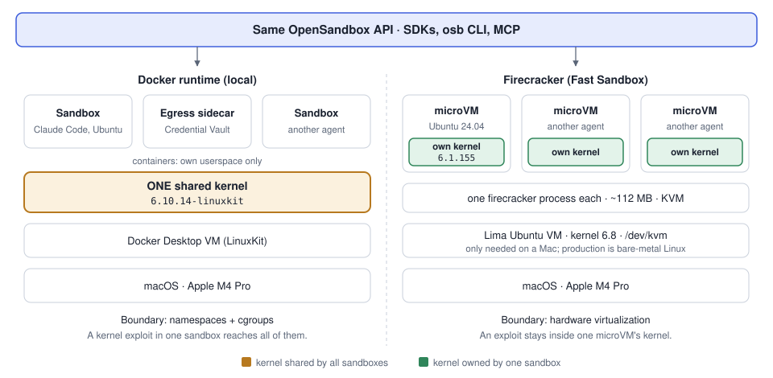

# Firecracker on a Mac (2026-11-11)

Goal: see how microVM sandboxes work (what OpenSandbox's Fast Sandbox builds on), without Kubernetes.

## Setup

Firecracker needs Linux with KVM (`/dev/kvm`); macOS has neither. [Lima](https://lima-vm.io) (CNCF) runs a
Linux VM on the Mac with Apple's Virtualization.framework. With nested virtualization (Apple M3+ and macOS 15+;
this Mac is an M4 Pro on macOS 26.6) that VM gets `/dev/kvm`, so Firecracker can start microVMs inside it.

```bash
brew install lima
limactl start --name=fcvm --vm-type=vz --set '.nestedVirtualization=true' --cpus=4 --memory=4 template:ubuntu-24.04
limactl shell fcvm ls -l /dev/kvm                          # must exist
limactl shell fcvm bash "$PWD/firecracker/setup.sh"        # Firecracker release + CI kernel + Ubuntu rootfs
limactl shell fcvm bash "$PWD/firecracker/run.sh"          # boot, SSH in, shut down
```

Three layers: macOS → Lima VM (Ubuntu, kernel 6.8, has KVM) → Firecracker microVM (kernel 6.1).

## Result

```text
microVM ready for SSH in 11.80 s (firecracker pid 3788)
--- inside the microVM:
Linux ubuntu-fc-uvm 6.1.155+ #1 SMP Thu Dec 18 15:12:13 UTC 2025 aarch64 aarch64 aarch64 GNU/Linux
PRETTY_NAME="Ubuntu 24.04.3 LTS"
1
               total        used        free      shared  buff/cache   available
Mem:             483          37         399           2          58         446
--- kernel boot milestone from the guest's console log:
[    1.760370] Freeing unused kernel memory: 2240K
--- host view: the whole VM is one process
    PID   RSS     ELAPSED CMD
   3788 114412      00:12 ./firecracker --api-sock .../fc/firecracker.sock --config-file vm_config.json
```

## Containers vs microVMs



Full page with the comparison table: [docs/containers-vs-microvms.html](../docs/containers-vs-microvms.html).

## What I learned

- **Own kernel per sandbox.** The microVM runs kernel 6.1.155 while its host runs 6.8. The Docker sandboxes
  shared Docker Desktop's LinuxKit kernel. A separate kernel is a much stronger isolation boundary.
- **A whole VM is one small process.** 1 vCPU, 512 MiB, about 112 MB RSS for the `firecracker` process.
  No BIOS, no PCI, few devices: that's why it's light (Firecracker was built for AWS Lambda and Fargate).
- **Configured by a JSON file or a REST API on a Unix socket** (`--api-sock`): kernel, root drive, tap
  network device, vCPUs and memory. The guest's IP comes from its MAC (CI rootfs convention).
- **Cold boot here is about 1.8 s for the kernel and 11.8 s to SSH**, slowed by nested virtualization and a
  full Ubuntu userspace. OpenSandbox's 64 ms P50 isn't a cold boot: Fast Sandbox restores from snapshots
  (pause/resume keeps memory and disk), on bare-metal KVM.

## Snapshot and restore (where the fast starts come from)

`firecracker/snapshot.sh`: boot, leave state that exists only in memory (a file in `/dev/shm` and a running
`sleep`), pause, snapshot, kill the Firecracker process, then restore into a brand-new process.

```text
== 1. cold boot
cold boot to SSH: 10653 ms (pid 5300)
== 2. leave state that lives only in memory
sleep pid 261
10.19 0.39
== 3. pause, snapshot, kill the process
snapshot written in 297 ms
  512M  vm.mem
  6.1K  vm.snap
original firecracker process killed
== 4. restore into a NEW process
snapshot load + resume: 7 ms; reachable over SSH: 1653 ms (new pid 5347)
== 5. is the memory state still there?
written at 06:29:33 before the snapshot
261 sleep 100000
13.27 0.68
```

- **7 ms to load and resume vs 10.6 s cold boot**, even nested on a Mac. The snapshot is the guest's whole RAM
  (`vm.mem`, 512 MB) plus a small device/vCPU state file (`vm.snap`, 6 KB).
- **Memory really came back:** the RAM-only file and the same `sleep` PID survived the original process being killed.
- **The guest never rebooted:** uptime continued (10.19 s, then 13.27 s); time just stopped while it was saved.
- SSH took 1.65 s after restore: the guest network and the SSH retry loop, not the VM. The VM ran after 7 ms.
- This is the mechanism behind OpenSandbox pause/resume (OSEP-0008, OSEP-0024) and fast template-backed creates:
  boot once, snapshot, then restore copies instead of booting.

## Gotchas

- Firecracker's CI bucket can lag releases: v1.18.0 had no CI kernel or rootfs yet, so `setup.sh` falls back to
  the newest line that has them (v1.15: kernel 6.1.155, Ubuntu 24.04). They boot fine with v1.18.
- Don't name the Lima VM `fc`: `fc` is a shell builtin, and some tooling treats it as a command.
- `Kvm error: Error creating KVM object: Permission denied`: the `/dev/kvm` ACL from `setfacl` dropped between
  Firecracker runs. Fix: add the user to the `kvm` group (`setup.sh` does it); the scripts also re-grant the ACL.
  `snapshot.sh` now fails fast if Firecracker exits, and shows Firecracker's API error bodies.
- `reboot` inside the guest prints "Failed to connect to bus"; harmless, `run.sh` kills Firecracker on exit.

## Next (optional)

- Restore several microVMs from one snapshot (a warm pool in miniature). Each clone needs its own tap device
  and MAC/IP, and clones share the same RNG state and identity, which real platforms must re-seed.
